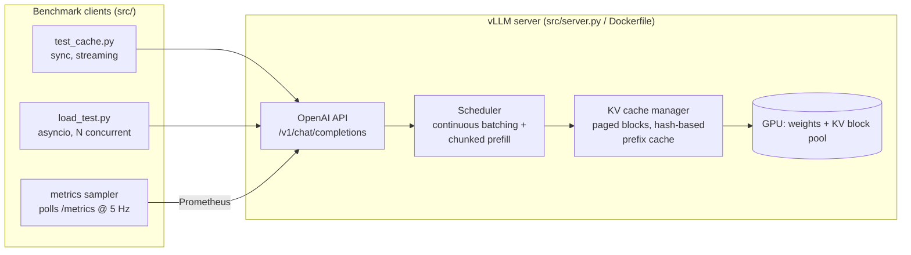
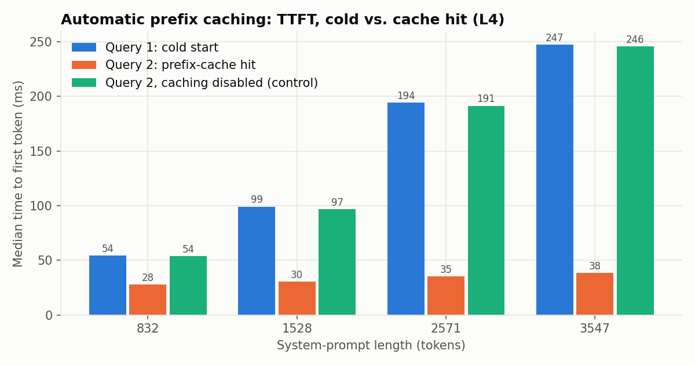
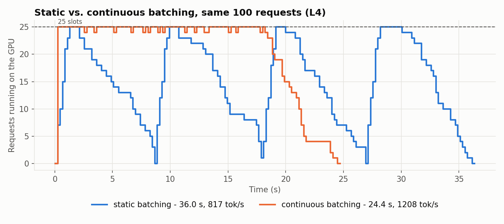
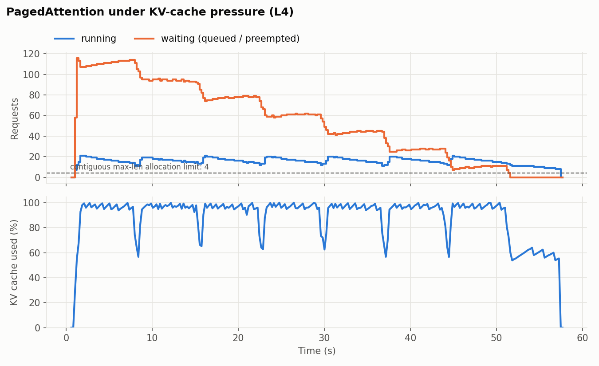
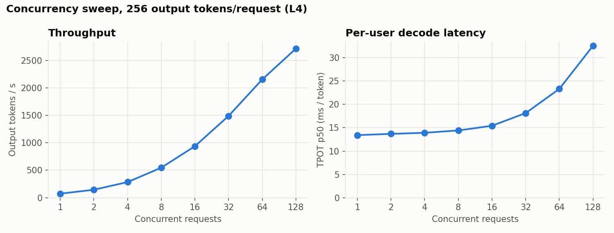

# High-Throughput LLM Serving: vLLM benchmarks on T4 / L4

A benchmarking harness that serves `Qwen2.5-1.5B-Instruct` behind vLLM's OpenAI-compatible API
and **measures** the four mechanisms that make LLM inference cheap: the **KV cache**,
**PagedAttention**, **automatic prefix caching** and **continuous batching**. Every claim in this
README links to an experiment you can rerun in Colab in about 30 minutes.

> Background on each mechanism (and what interviewers ask about it): [`docs/concepts.md`](docs/concepts.md)

## Architecture



## Experiments

| # | Concept | Script | What it shows | Chart |
|---|---|---|---|---|
| 0 | KV cache | `src/kv_cache_demo.py` | decode with vs. without cache; prefill (compute-bound) vs. decode (memory-bound); batch-decode scaling; KV bytes/token | `kv_cache_vs_none`, `prefill_vs_decode`, `batch_decode` |
| 0 | PagedAttention | `src/kv_cache_demo.py` | contiguous vs. paged KV allocation under realistic traffic (simulation) | `kv_fragmentation` |
| 3 | Prefix caching | `src/test_cache.py` | cold vs. cache-hit TTFT across 750-3500-token system prompts, with a caching-disabled control | `prefix_cache_ttft` |
| 4 | Continuous batching | `src/load_test.py --scenario burst` | 25 concurrent requests, zero failures, ≈ the time of one | (table) |
| 4 | Continuous batching | `--scenario batching` | static waves vs. continuous admission on identical requests | `batching_timeline` |
| 4 | Throughput/latency | `--scenario sweep` | tok/s and TPOT vs. concurrency 1 to 128 | `concurrency_sweep` |
| 4 | PagedAttention | `--scenario pressure` on a KV-starved server | running sequences above the contiguous-allocation limit; preemption instead of OOM | `kv_pressure` |

## Results (NVIDIA L4, vLLM 0.30.0, Qwen2.5-1.5B-Instruct fp16)

| Mechanism | Measured result |
|---|---|
| KV cache | Generating 256 tokens after a 1,536-token prompt: **7.8 s with cache vs. 31.8 s without (4.1×)**; the final step took 30 ms vs. 143 ms |
| Prefix caching | TTFT **247 → 39 ms (−84%)** on a 3,547-token system prompt; −49% at 832 tokens. Control with caching disabled: second query within 1.2% of the first |
| Continuous batching | Same 100 mixed-length requests: **24.4 s vs. 36.0 s for static batching (1.48×)**; mean GPU slot occupancy 20.9/25 vs. 15.0/25 |
| Concurrency | 25-request burst: **0 failures**, done in 1.9× the time of a single request. Throughput **74 → 2,714 tok/s (37×)** from 1 to 128 concurrent requests, while per-user TPOT rose 13.4 → 32.6 ms |
| PagedAttention | With a 16,384-token KV pool (room for **4** max-length contiguous reservations), vLLM ran **21 sequences concurrently** at ~100% KV utilization, preempting 51 times with **0 failed requests** |






### What the numbers say

* **Prefill is compute-bound, decode is memory/overhead-bound.** In raw transformers, prefill holds ~14.5K tok/s once past ~512 tokens, while a decode step costs ~31 ms at every context length from 128 to 4,096 ([chart](benchmarks/prefill_vs_decode_L4.png)).
* **Batching decode is close to free.** A decode step costs 31.0 ms at batch 1 and 31.6 ms at batch 64, so throughput rises 63× ([chart](benchmarks/batch_decode_L4.png)). That is the economic argument for continuous batching.
* **Launch overhead matters as much as FLOPs.** Raw-transformers decode (31 ms/token) runs about 3× above the L4's memory-bandwidth floor (~10 ms for 3.1 GB of weights at 300 GB/s). vLLM with CUDA graphs reaches **13.4 ms/token**. At short contexts this overhead also hides the cost of skipping the KV cache, so the cache experiment uses a 1.5K-token prompt.
* **Prefix-cache gains scale with the cached fraction.** Only full 16-token blocks are reused (3,520 of 3,547 tokens), and decode time is unchanged, so end-to-end latency improves less (−19% with 64 output tokens) than TTFT does.
* **The throughput/latency knee.** Up to 16 concurrent requests, TPOT stays within 15% of single-stream. Past that, TPOT and p99 TTFT climb steeply. That knee is where `--max-num-seqs` or an autoscaling threshold belongs for a latency SLO.

Full tables: [`benchmarks/summary_L4.md`](benchmarks/summary_L4.md). Raw per-request data: `benchmarks/*.json`.

## Run it

**Colab (recommended):** push this repo to GitHub, open `notebooks/colab_runner.ipynb` in Colab,
pick an L4 or T4 runtime, set `REPO_URL`, then Run all.

**Any Linux box with an NVIDIA GPU:**
```bash
pip install -r requirements.txt
python -m src.kv_cache_demo                 # before the server: both need the GPU
./start_server.sh                           # background; waits for /health
python -m src.test_cache
python -m src.server start --no-prefix-caching && python -m src.test_cache && python -m src.server start
python -m src.load_test --scenario all
python -m src.server start --num-gpu-blocks 1024 && python -m src.load_test --scenario pressure --tag starved
python -m src.plot_metrics
python -m src.server stop
```

**Docker:**
```bash
docker build -t llm-serving .
docker run --gpus all --ipc=host -p 8000:8000 -v ~/.cache/huggingface:/root/.cache/huggingface llm-serving
```

> Apple Silicon: vLLM's CUDA path doesn't run on Metal, so use Colab for the GPU experiments.
> The client scripts and `kv_cache_demo --only kv_math` run anywhere.

## Design decisions

* **TTFT is measured with streaming.** Non-streaming responses arrive only when generation is done, which hides the prefill/decode split.
* **Output length is a controlled variable.** `ignore_eos` + `max_tokens` make every request generate exactly the intended number of tokens, so runs are comparable.
* **Cold starts are guaranteed, not hoped for.** A nonce in the first line of the system prompt changes the first KV block's hash, and that invalidates the whole chained prefix.
* **Every experiment has a control.** Prefix caching is compared against a caching-disabled server; continuous batching is compared against static waves on the *same* engine and requests, so the only variable is the scheduling policy.
* **Server-side truth from Prometheus.** Running/waiting requests, KV usage, prefix-cache hits and preemptions are sampled from `/metrics` during every run, alongside client-side latencies.
* **The notebook kernel never imports torch.** GPU work runs in subprocesses, so the server can be restarted with new flags without restarting the runtime.
* **T4 support:** Turing has no bf16 or FlashAttention-2, so the launcher detects SM < 8.0 and switches to `--dtype half --attention-backend TRITON_ATTN`.

## Repository layout

```
src/
  config.py         shared settings, GPU detection
  server.py         vLLM lifecycle: start (with flags) / stop / status / logs
  client.py         streaming timed requests (sync + async), Prometheus parser
  prompts.py        deterministic enterprise-RAG system prompts sized with the model tokenizer
  kv_cache_demo.py  Phase 0 KV-cache lab (raw transformers)
  test_cache.py     Phase 3 prefix caching
  load_test.py      Phase 4 burst / batching / sweep / pressure
  plot_metrics.py   Phase 5 charts + summary markdown
notebooks/colab_runner.ipynb   end-to-end Colab driver
docs/concepts.md               theory + interview notes
start_server.sh, Dockerfile, requirements.txt
```

## Possible extensions

* fp8 KV cache (`--kv-cache-dtype fp8`, L4 only): measure the capacity gain against quality.
* Speculative decoding (n-gram or a draft model): TPOT improvement at low vs. high concurrency.
* Prefix-aware routing across two replicas behind a small router: cache hit rate vs. round-robin.
* Build a minimal paged KV cache + iteration-level scheduler from scratch in PyTorch (a "nano-vLLM").
